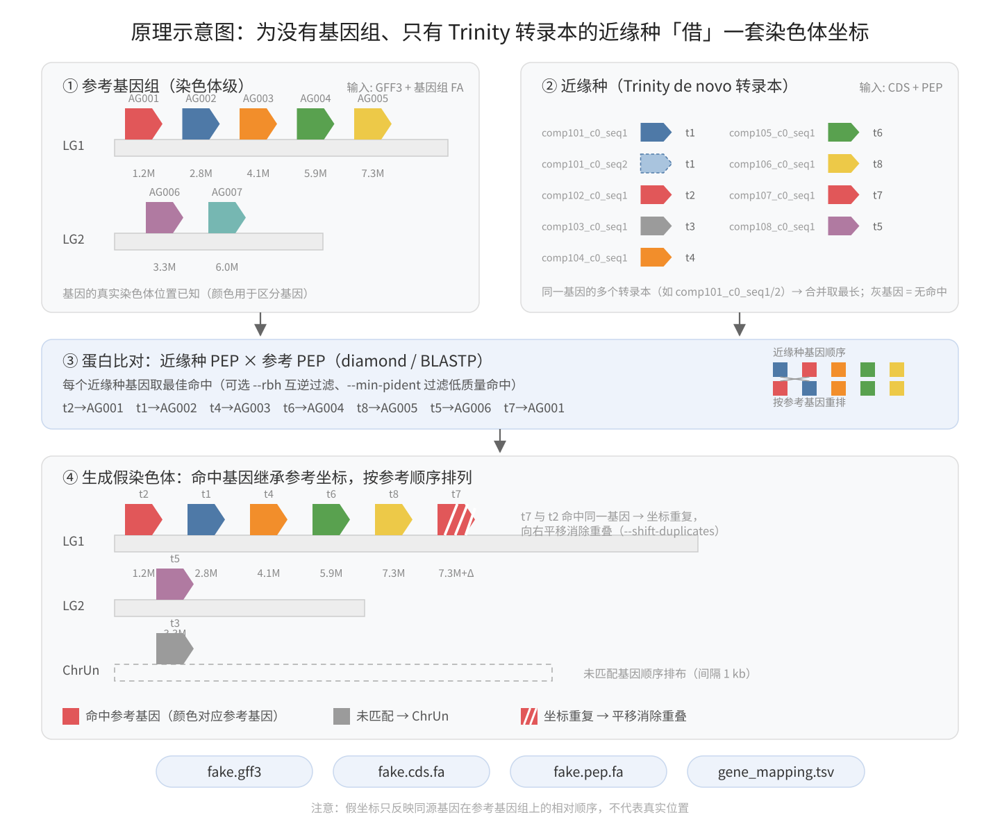

# fake_chromosome_gff

为一个**只有 CDS/PEP（如 Trinity de novo 转录组组装）、没有基因组组装**的近缘种，基于染色体级别的参考基因组生成一份"假染色体" GFF。

典型用途：MCScanX / WGDI / 共线性绘图等工具要求输入带坐标的 GFF；当目标物种只有转录组或注释序列时，可以用近缘种的染色体框架"借"一套坐标，让基因按参考基因组的染色体顺序排列。

[English README](README_English.md)

## 原理



1. 从参考基因组（GFF + FA，或 GFF + CDS/PEP）取得基因位置与蛋白序列；近缘种按基因合并转录本（如 Trinity 的 compXXX_c0_seq1/2 属同一基因），每基因取最长 CDS/PEP。
2. 近缘种 PEP 与参考 PEP 蛋白比对（diamond / BLASTP 最佳命中，可选 `--rbh` 互逆过滤、`--min-pident` 过滤低质量命中）。
3. 匹配上的基因继承参考同源基因的染色体与坐标，按参考位置排序；未匹配上的放到 ChrUn 伪染色体顺序排布。
4. 重新编号（Chr01G000010）→ 输出 `fake.gff3` / `fake.cds.fa` / `fake.pep.fa` / `gene_mapping.tsv`。

注意：**坐标不代表真实位置**，只反映"该基因在参考基因组上的同源基因排在哪"。

## 依赖

- Python 3.9+，Biopython
- 蛋白比对器（二选一，推荐 diamond）：
  - **DIAMOND**（`diamond`，默认 auto 模式下优先使用，比 BLASTP 快约 60 倍）
  - BLAST+（`makeblastdb` / `blastp`）

## 安装

```bash
conda env create -f environment.yml
conda activate fake-chrom-gff
```

环境包含 python、biopython、diamond 与 blast（后者为兜底比对器），激活后直接运行 `fake_chrom_gff.py` 即可。
若已有环境，也可手动安装：`conda install -c bioconda -c conda-forge python biopython diamond blast`。

## 用法

模式 A：参考基因组为 GFF + 基因组 fasta（从基因组提取 CDS/PEP）：

```bash
python3 fake_chrom_gff.py \
    --ref-gff ref.gff3 --ref-fa ref.genome.fa \
    --cds rel.cds.fa --pep rel.pep.fa \
    --outdir out
```

模式 B：参考基因组为 GFF + CDS + PEP：

```bash
python3 fake_chrom_gff.py \
    --ref-gff ref.gff3 --ref-cds ref.cds.fa --ref-pep ref.pep.fa \
    --cds rel.cds.fa --pep rel.pep.fa \
    --outdir out --rbh
```

### 典型流程：trinity-rust 转录本 + TransDecoder

目标物种无基因组、只有 RNA-seq 时，标准输入链路如下（脚本自动识别
`compXXX_c0_seq1`（CDS）/ `compXXX_c0_seq1.p1`（PEP）这类 Trinity+TransDecoder ID）：

```bash
# 1. trinity-rust 组装（默认产物 principal.fa 已去冗余，每基因一条代表转录本）
trinity-cli --seqType fq --left reads.left.fq.gz --right reads.right.fq.gz \
    --CPU 16 --max_memory 64G --output sample
#    → sample.Trinity.principal.fa

# 2. TransDecoder 预测 ORF（推荐）
TransDecoder.LongOrfs -t sample.Trinity.principal.fa
TransDecoder.Predict -t sample.Trinity.principal.fa
#    → sample.Trinity.principal.fa.transdecoder.cds / .pep

# 3. 生成假染色体 GFF
python3 fake_chrom_gff.py \
    --ref-gff ref.gff3 --ref-fa ref.genome.fa \
    --cds sample.Trinity.principal.fa.transdecoder.cds \
    --pep sample.Trinity.principal.fa.transdecoder.pep \
    --outdir out --sensitive --shift-duplicates
```

若使用全量 `Trinity.fasta`（含全部 isoform），同一基因的多个 `compXXX_c0_seqN`
会被自动合并、取最长，无需预先去冗余。

### 主要参数

| 参数 | 说明 | 默认 |
|---|---|---|
| `--ref-gff` | 参考基因组 GFF3（需含 gene/mRNA/CDS） | 必填 |
| `--ref-fa` | 参考基因组 fasta（与 --ref-cds/--ref-pep 二选一） | |
| `--ref-cds` / `--ref-pep` | 参考 CDS / PEP fasta（两者需同时给） | |
| `--cds` / `--pep` | 近缘种 CDS / PEP fasta | 必填 |
| `--evalue` | 蛋白比对 e-value 阈值 | `1e-5` |
| `--aligner` | `auto` / `diamond` / `blastp`，auto 优先 diamond | `auto` |
| `--sensitive` | diamond 使用 `--more-sensitive`，找回约 3% 的匹配（稍慢，仅 diamond 有效） | 关 |
| `--min-pident` | 最佳命中 pident 低于该值的基因按未匹配处理（远缘种可设 30~50 过滤低质量命中） | `0`（不过滤） |
| `--shift-duplicates` | 共享参考坐标的基因向右平移，保证任意两基因不重叠（外群实测平移 9,484 个，零重叠、顺序不变；推荐 MCScanX 使用） | 关 |
| `--rbh` | 仅保留 reciprocal best hit（双向最佳命中） | 关 |
| `--tag` | 基因编号标签，如 `Chr01G000010` 中的 G | `G` |
| `--chrun` | 未匹配基因所在伪染色体名 | `ChrUn` |
| `--gap` | ChrUn 上基因间间隔 (bp) | `1000` |
| `--make-genome` | 额外输出 N 填充的 fake.genome.fa | 关 |
| `--threads` | 比对线程数 | `4` |

## 实测（某植物染色体级参考基因组，28,481 基因）

| 近缘种 | 比对器 | 耗时 | 匹配 | 进 ChrUn | 与 BLASTP 赋值一致率* |
|---|---|---|---|---|---|
| 近缘种 A，属内 (33,967 基因) | BLASTP 16线程 | 8m41s | 31,208 | 2,759 | — |
| 同上 | diamond | **8s** | 30,359 | 3,608 | 88.5% |
| 同上 | diamond --sensitive | 22s | 31,061 | 2,906 | 91.9% |
| 近缘种 B，属内 (61,029 基因, scaffold 级组装) | BLASTP 16线程 | 9m34s | 37,828 | 23,200 | — |
| 同上 | diamond | **9.6s** | 36,310 | 24,718 | 92.6% |
| 同上 | diamond --sensitive | 33s | 37,472 | 23,556 | 94.5% |
| 外群，远缘 (22,823 基因) | diamond | 6.9s | 20,927 | 1,896 | — |

\* 一致率 = 对同一近缘种基因，diamond 与 BLASTP 给出的参考基因相同的比例。

结论：diamond 速度快 60 倍左右，默认模式比 BLASTP 少匹配约 3%（多是弱命中）；
加 `--sensitive` 后基本追平 BLASTP，仍快约 20 倍。近缘种 B 匹配率只有 ~62% 是其
组装为 scaffold 级（2,314 条）、基因碎片化所致，并非脚本问题。


## 输出

| 文件 | 内容 |
|---|---|
| `fake.gff3` | 假染色体 GFF3（gene/mRNA/exon/CDS 四级特征，`##sequence-region` 头） |
| `fake.cds.fa` | 按假染色体顺序重排的近缘种 CDS，头为 `新ID.t1 原ID` |
| `fake.pep.fa` | 同上，蛋白序列 |
| `gene_mapping.tsv` | 新 ID → 原 ID / 参考基因 / 坐标 / 比对信息对照表 |
| `fake.genome.fa` | （可选）N 填充的假基因组 |

## ID 处理规则

- fasta 头取第一个空格前的字段作为序列 ID。
- 转录本后缀自动合并为基因：`.1`、`.t1`、`.T1`、`-T1`、`-RA` 等结尾会被剥离
  （如 `gene001.1` / `gene001.t2` 归为基因 `gene001`）；同一基因多条转录本取最长。
- 兼容 Trinity de novo 组装：TransDecoder 风格的 `compXXX_c0_seq1.p1`（CDS 为
  `compXXX_c0_seq1`）会循环剥离 `.p1`、`_seq1` 后缀，同一基因的多个 isoform
  正确合并为基因 `compXXX_c0` 并取最长。
- 参考序列与 GFF 的对应顺序：精确转录本 ID → 精确基因 ID → 去后缀匹配。

## 注意事项与局限

- 假 GFF 的坐标直接继承参考同源基因，因此**多个近缘种基因可能命中同一参考基因而坐标重复**（近缘种特有的串联重复/旁系同源），统计信息里会报告数量；MCScanX 等工具建议加 `--shift-duplicates` 消除重叠。
- 仅 CDS 无 PEP 的基因无法参与比对，一律放入 ChrUn。
- 假基因均为单外显子（gene/mRNA/exon/CDS 同跨度），CDS phase 记为 0；不要用它提取上游调控序列或做任何依赖真实序列/真实结构的分析。
- 染色体顺序按参考 GFF 中 seqid 的出现顺序；若给了 `--ref-fa`，`##sequence-region` 长度取真实染色体长度，否则按基因末端 + 10 kb 估算。

## 测试

```bash
python3 tests/make_test_data.py                 # 生成模拟数据 (tests/data/)
python3 fake_chrom_gff.py --ref-gff tests/data/ref.gff3 \
    --ref-fa tests/data/ref.genome.fa \
    --cds tests/data/rel.cds.fa --pep tests/data/rel.pep.fa \
    --outdir tests/out_modeA
python3 tests/check_test.py tests/out_modeA     # [PASS]
```
