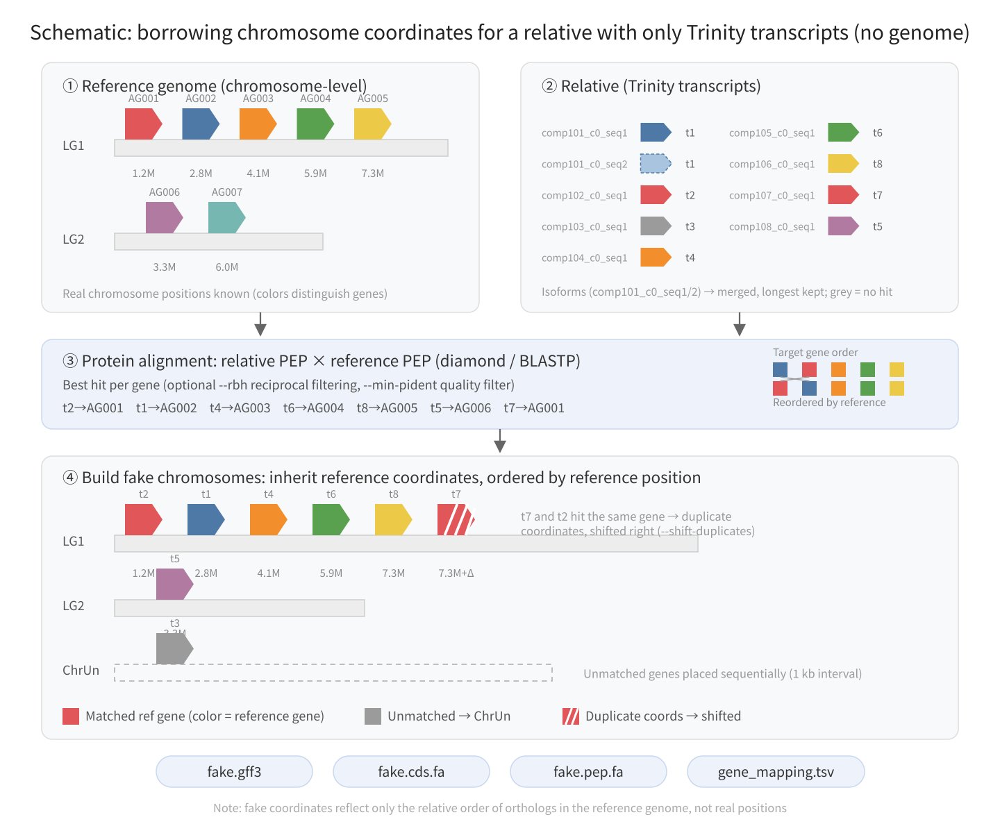

# fake_chromosome_gff

Generate a "fake chromosome" GFF for a relative species that has **only CDS/PEP sequences (e.g. a Trinity de novo transcriptome assembly) and no genome assembly**, using a chromosome-level reference genome.

> For the transcriptome assembly step, check out [trinity-rust](https://github.com/shengxinzhuan/trinity-rust) — a Rust port of the Trinity v2.15.2 main assembly pipeline: **~3x faster** than the original (54 → 17 min end-to-end), **~4x lower peak memory** (83 → 21 GB), and **zero-hassle full pipeline** (single static binary, no Perl/Java toolchain, automatic multi-k, deduplicated deliverables and checkpoint-resume out of the box). Its default `*.Trinity.principal.fa` (one representative transcript per gene) is a drop-in input for this tool.

Typical use case: tools like MCScanX / WGDI / synteny-plotting pipelines require a GFF with coordinates. When the target species has only transcriptome or annotation sequences, this script "borrows" a coordinate framework from the chromosome-level assembly of a relative, so that genes are arranged in the chromosomal order of the reference genome.

[中文版 README](README.md)

## How it works



1. Gene positions and protein sequences are taken from the reference genome (GFF + FA, or GFF + CDS/PEP); target transcripts are merged per gene (e.g. Trinity isoforms `compXXX_c0_seq1/2` belong to one gene) and the longest CDS/PEP per gene is kept.
2. Target PEP is aligned against reference PEP (diamond / BLASTP best hit; optional `--rbh` reciprocal-best filtering and `--min-pident` low-quality filtering).
3. Matched genes inherit the chromosome and coordinates of their reference ortholog and are sorted by reference position; unmatched genes are placed sequentially on a pseudo-chromosome `ChrUn`.
4. New IDs are assigned (`Chr01G000010`) → outputs `fake.gff3` / `fake.cds.fa` / `fake.pep.fa` / `gene_mapping.tsv`.

Note: **the coordinates do NOT represent real positions**; they only reflect "where the ortholog of this gene sits in the reference genome".

## Dependencies

- Python 3.9+, Biopython
- A protein aligner (either; diamond recommended):
  - **DIAMOND** (`diamond`; preferred in the default `auto` mode, ~60x faster than BLASTP)
  - BLAST+ (`makeblastdb` / `blastp`)

## Installation

```bash
conda env create -f environment.yml
conda activate fake-chrom-gff
```

The environment ships python, biopython, diamond and blast (the latter as a fallback aligner); once activated, run `fake_chrom_gff.py` directly.
To install into an existing environment instead: `conda install -c bioconda -c conda-forge python biopython diamond blast`.

## Usage

Mode A: reference given as GFF + genomic fasta (CDS/PEP extracted from the genome):

```bash
python3 fake_chrom_gff.py \
    --ref-gff ref.gff3 --ref-fa ref.genome.fa \
    --cds rel.cds.fa --pep rel.pep.fa \
    --outdir out
```

Mode B: reference given as GFF + CDS + PEP:

```bash
python3 fake_chrom_gff.py \
    --ref-gff ref.gff3 --ref-cds ref.cds.fa --ref-pep ref.pep.fa \
    --cds rel.cds.fa --pep rel.pep.fa \
    --outdir out --rbh
```

### Typical workflow: trinity-rust transcripts + TransDecoder

When the target species has no genome and only RNA-seq data, the standard input chain is as follows (the script automatically recognizes Trinity+TransDecoder-style IDs: `compXXX_c0_seq1` for CDS, `compXXX_c0_seq1.p1` for PEP):

```bash
# 1. Assemble with trinity-rust (https://github.com/shengxinzhuan/trinity-rust)
#    ~3x faster and ~4x lower memory than original Trinity,
#    single-binary zero-hassle pipeline; default principal.fa is already
#    deduplicated (one representative transcript per gene)
trinity-cli --seqType fq --left reads.left.fq.gz --right reads.right.fq.gz \
    --CPU 16 --max_memory 64G --output sample
#    → sample.Trinity.principal.fa

# 2. ORF prediction with TransDecoder (recommended)
TransDecoder.LongOrfs -t sample.Trinity.principal.fa
TransDecoder.Predict -t sample.Trinity.principal.fa
#    → sample.Trinity.principal.fa.transdecoder.cds / .pep

# 3. Generate the fake-chromosome GFF
python3 fake_chrom_gff.py \
    --ref-gff ref.gff3 --ref-fa ref.genome.fa \
    --cds sample.Trinity.principal.fa.transdecoder.cds \
    --pep sample.Trinity.principal.fa.transdecoder.pep \
    --outdir out --sensitive --shift-duplicates
```

If you use the full `Trinity.fasta` (with all isoforms) instead, multiple `compXXX_c0_seqN` transcripts of the same gene are merged automatically (longest wins) — no pre-deduplication needed.

### Main parameters

| Parameter | Description | Default |
|---|---|---|
| `--ref-gff` | Reference genome GFF3 (must contain gene/mRNA/CDS features) | required |
| `--ref-fa` | Reference genomic fasta (mutually exclusive with --ref-cds/--ref-pep) | |
| `--ref-cds` / `--ref-pep` | Reference CDS / PEP fasta (must be given together) | |
| `--cds` / `--pep` | Relative species CDS / PEP fasta | required |
| `--evalue` | Protein alignment e-value cutoff | `1e-5` |
| `--aligner` | `auto` / `diamond` / `blastp`; auto prefers diamond | `auto` |
| `--sensitive` | diamond `--more-sensitive` mode, recovers ~3% more matches (slightly slower, diamond only) | off |
| `--min-pident` | Genes whose best hit pident is below this value are treated as unmatched (for distant relatives, 30–50 filters low-quality hits) | `0` (no filter) |
| `--shift-duplicates` | Shift genes sharing reference coordinates to the right so that no two genes overlap (9,484 shifted in a real outgroup test: zero overlaps, order preserved; recommended for MCScanX) | off |
| `--rbh` | Keep only reciprocal best hits | off |
| `--tag` | Gene-numbering tag, e.g. the G in `Chr01G000010` | `G` |
| `--chrun` | Name of the pseudo-chromosome for unmatched genes | `ChrUn` |
| `--gap` | Inter-gene interval on ChrUn (bp) | `1000` |
| `--make-genome` | Also output an N-filled fake.genome.fa | off |
| `--threads` | Alignment threads | `4` |

## Benchmarks (a plant chromosome-level reference genome, 28,481 genes)

| Relative species | Aligner | Time | Matched | To ChrUn | Assignment agreement with BLASTP* |
|---|---|---|---|---|---|
| Relative A, same genus (33,967 genes) | BLASTP, 16 threads | 8m41s | 31,208 | 2,759 | — |
| same | diamond | **8s** | 30,359 | 3,608 | 88.5% |
| same | diamond --sensitive | 22s | 31,061 | 2,906 | 91.9% |
| Relative B, same genus (61,029 genes, scaffold-level assembly) | BLASTP, 16 threads | 9m34s | 37,828 | 23,200 | — |
| same | diamond | **9.6s** | 36,310 | 24,718 | 92.6% |
| same | diamond --sensitive | 33s | 37,472 | 23,556 | 94.5% |
| Outgroup, distant (22,823 genes) | diamond | 6.9s | 20,927 | 1,896 | — |

\* Agreement = fraction of target genes for which diamond and BLASTP assign the same reference gene.

Conclusion: diamond is ~60x faster; its default mode misses ~3% of matches compared to BLASTP (mostly weak hits). With `--sensitive` it essentially catches up with BLASTP while remaining ~20x faster. Relative B's low match rate (~62%) is caused by its fragmented scaffold-level assembly (2,314 scaffolds), not by this script.

## Outputs

| File | Content |
|---|---|
| `fake.gff3` | Fake-chromosome GFF3 (gene/mRNA/exon/CDS features, `##sequence-region` headers) |
| `fake.cds.fa` | Target CDS reordered along the fake chromosomes, headers `newID.t1 originalID` |
| `fake.pep.fa` | Same, protein sequences |
| `gene_mapping.tsv` | New ID → original ID / reference gene / coordinates / alignment stats |
| `fake.genome.fa` | (Optional) N-filled fake genome |

## ID handling rules

- The sequence ID is the first whitespace-delimited field of the fasta header.
- Transcript suffixes are stripped to obtain gene IDs: endings like `.1`, `.t1`, `.T1`, `-T1`, `-RA` are removed (e.g. `gene001.1` / `gene001.t2` → gene `gene001`); for multiple transcripts per gene, the longest is kept.
- Trinity de novo assemblies are supported: TransDecoder-style `compXXX_c0_seq1.p1` (CDS: `compXXX_c0_seq1`) has `.p1` and `_seq1` stripped iteratively, so multiple isoforms of one gene collapse correctly to `compXXX_c0` (longest wins).
- Matching reference sequences to GFF genes is attempted in this order: exact transcript ID → exact gene ID → suffix-stripped match.

## Caveats and limitations

- Fake-GFF coordinates are inherited directly from reference orthologs, so **multiple target genes may hit the same reference gene and end up with identical coordinates** (tandem duplicates / paralogs specific to the target). The stats report how many; for tools like MCScanX, add `--shift-duplicates` to remove overlaps.
- Genes with CDS but no PEP cannot be aligned and are always placed on ChrUn.
- Fake genes are single-exon (gene/mRNA/exon/CDS share the same span) with CDS phase 0; do NOT use this GFF to extract upstream regulatory sequences or for any analysis that depends on real sequence or real gene structure.
- Chromosome order follows the order of seqids in the reference GFF. With `--ref-fa`, `##sequence-region` lengths are the real chromosome lengths; otherwise they are estimated as the last gene end + 10 kb.

## Testing

```bash
python3 tests/make_test_data.py                 # generate simulated data (tests/data/)
python3 fake_chrom_gff.py --ref-gff tests/data/ref.gff3 \
    --ref-fa tests/data/ref.genome.fa \
    --cds tests/data/rel.cds.fa --pep tests/data/rel.pep.fa \
    --outdir tests/out_modeA
python3 tests/check_test.py tests/out_modeA     # [PASS]
```

## See also

- **[trinity-rust](https://github.com/shengxinzhuan/trinity-rust)** — a Rust port of the
  Trinity RNA-Seq de novo assembler (v2.15.2 main pipeline). Highlights: **faster** (~1/3
  the end-to-end runtime of the original), **leaner** (~1/4 the peak memory), and a
  **zero-hassle pipeline** (single static binary with no Perl/Java toolchain; automatic
  multi-k assembly, deduplicated deliverables and checkpoint-resume by default — one
  command from reads to results). Its default `*.Trinity.principal.fa` (one representative
  transcript per gene) feeds directly into this tool's `--cds/--pep` workflow.
